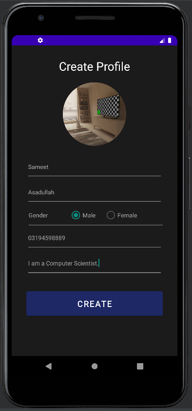
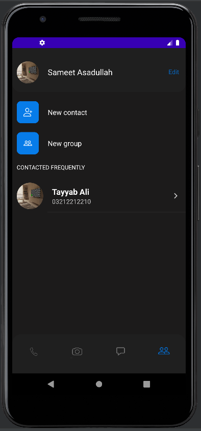
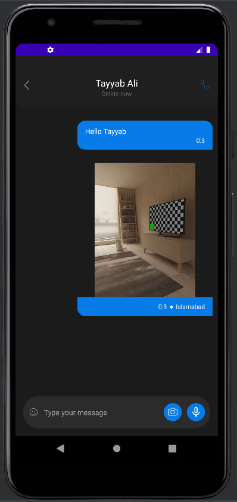
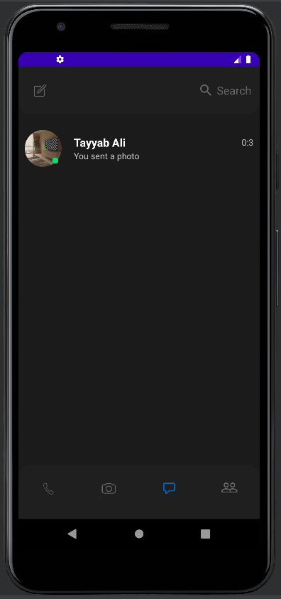
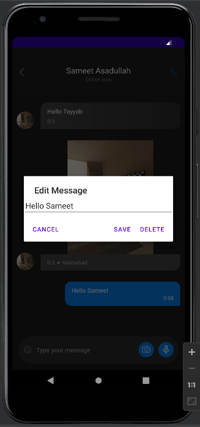

# Bisto Chat — Firebase Android Client

A Java Android messaging application backed by Firebase Authentication, Realtime Database, and Storage. Bisto supports user profiles, contact discovery, real-time text and image conversations, message editing/deletion, group interfaces, and screenshot-aware chat events.

## Features

- Email/password registration and sign-in.
- User profiles with personal details and profile pictures.
- Contact and recent-conversation views.
- Real-time text and image messaging.
- Message editing and deletion through long-press actions.
- Group-creation interface and call-history screens.
- Screenshot detection that can publish a captured image to the conversation.
- Local SQLite support alongside Firebase synchronization.

See [Architecture](docs/ARCHITECTURE.md) for the client structure and Firebase responsibilities.

## Technology

- Java and Android SDK
- Firebase Authentication
- Firebase Realtime Database
- Firebase Storage
- RecyclerView and Material Components
- Picasso image loading
- JUnit and Android instrumentation tests

## Run locally

1. Open the `src` directory in Android Studio.
2. Create a Firebase project and register an Android app with package name `com.sameetasadullah.i180479_180531`.
3. Enable Email/Password authentication, Realtime Database, and Storage.
4. Download your Firebase `google-services.json` into `src/app`.
5. Configure appropriate Firebase Security Rules for your development environment.
6. Build and run on an Android device or emulator running API 26 or newer.

`google-services.json` is deliberately excluded from version control. [`google-services.example.json`](src/app/google-services.example.json) documents the expected structure without containing a live Firebase project configuration.

## Screenshots

| Splash | Sign in | Sign up | Profile setup |
| --- | --- | --- | --- |
|  |  |  |  |

| Contacts | Conversation | Chat list | Message actions |
| --- | --- | --- | --- |
|  |  |  |  |

## Project status

This repository preserves the original 2021 Android implementation. Before production deployment, remove password duplication from profile records, review Firebase rules, modernize Android storage handling, and update dependencies.

## Contributors

- [Sameet Asadullah](https://github.com/SameetAsadullah)
- [Tayyab Ali](https://github.com/DarkDragz)

## License

Licensed under the [MIT License](LICENSE).
